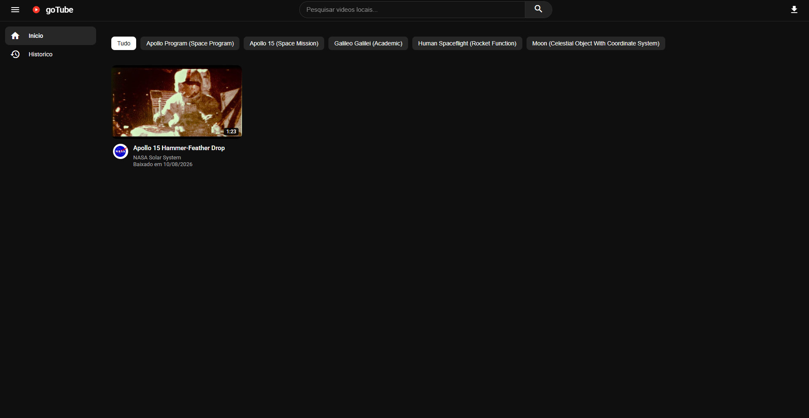
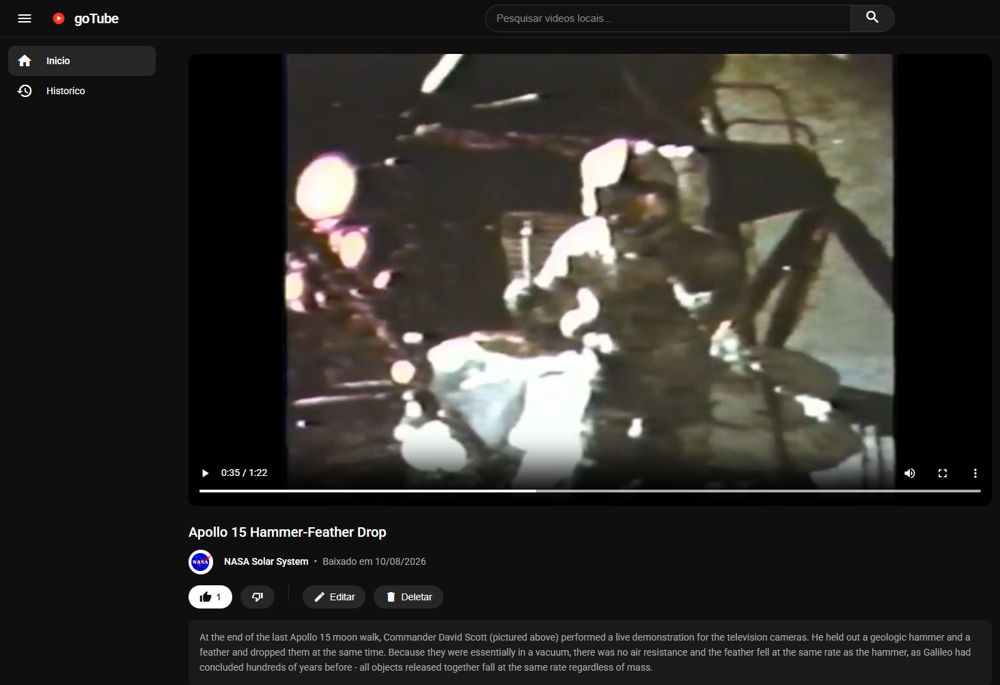
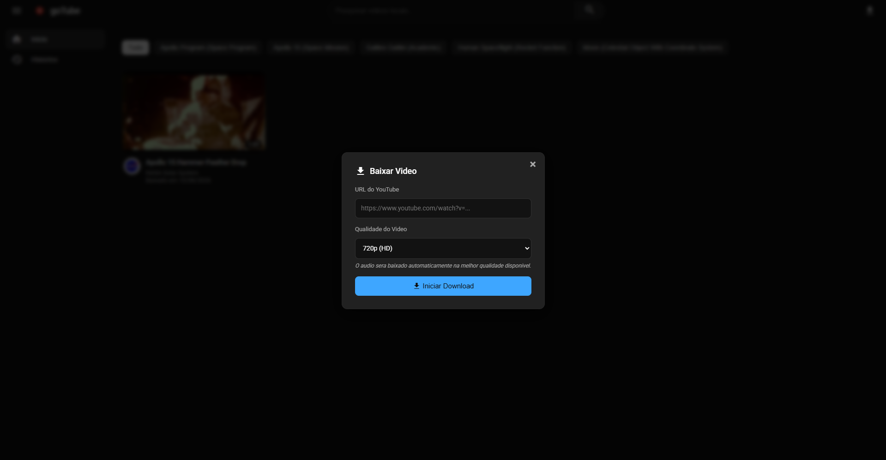

<div align="center">


# goTube

[](https://github.com/GuilhermeWilliamofc/GoTube/releases)
[](https://github.com/GuilhermeWilliamofc/GoTube/releases)
[](https://github.com/GuilhermeWilliamofc/GoTube/blob/main/LICENSE)

**Player e organizador de biblioteca de mídia local e offline**

</div>

---

O **goTube** é um player e organizador de biblioteca de vídeos local focado em oferecer uma experiência fluida de streaming para mídia offline. Todo o conteúdo é gerenciado a partir de uma biblioteca local (vídeos previamente importados ou adicionados à coleção), e o aplicativo constrói automaticamente um feed, páginas de reprodução, categorização por tags e um sistema de recomendações inteligente baseado nos metadados da sua coleção.

> **💡 Inspiração:** O nome e a proposta do projeto prestam uma singela homenagem ao conceito do antigo *YouTube Go* (aplicativo mobile descontinuado em 2022, criado originalmente para permitir o consumo offline de vídeos com escolha consciente de qualidade). O **goTube** resgata essa ideia de independência de conexão e a expande para o desktop, permitindo que você construa sua própria biblioteca pessoal permanente.

---

## 🚀 Principais Funcionalidades

- **Experiência Offline Fluida:** Navegue pela sua coleção de vídeos locais com uma interface moderna e intuitiva inspirada nas principais plataformas de streaming.
- **Feed e Catalogação Automática:** Novos vídeos adicionados à pasta de mídia são indexados automaticamente no feed do aplicativo.
- **Player Dedicado:** Página de reprodução completa com controles nativos de volume, tela cheia, barra de progresso, título, descrição e detalhes do arquivo.
- **Recomendações Locais:** Sistema de sugestões baseado em tags e categorias, funcionando 100% offline sem necessidade de conexão com a internet.
- **Importador de Mídia Integrado:** Módulo para importar vídeos via link da web com seleção de qualidade (144p até 1080p Full HD) e extração de áudio em alta fidelidade.
- **Edição de Metadados:** Altere títulos, descrições, tags e avatares diretamente pela interface do aplicativo.
- **Persistência Local:** Metadados estruturados em formato JSON (`library.json`), permitindo backup e portabilidade simples da sua biblioteca.

---

## 📸 Capturas de Tela

<div align="center">

### Página Inicial (Feed da Biblioteca)


<br/><br/>

### Player Integrado de Vídeo


<br/><br/>

### Importador de Mídia


</div>

---

## 🛠️ Stack Tecnológica

- **Frontend / Aplicação:** [Electron.js](https://www.electronjs.org/) (HTML5, CSS3 moderno com tema escuro, JavaScript Vanilla).
- **Arquitetura:** Padrão MVC (Model-View-Controller) para organização e separação de responsabilidades.
- **Backend / Scripts Auxiliares:** Python 3.10+ para processamento de streams, metadados e mídia.
- **Processamento de Mídia:** FFmpeg integrado para multiplexação de áudio e vídeo de alta qualidade.
- **Comunicação:** IPC (`child_process` e eventos Electron) entre a interface e os scripts do sistema.

---

## 📦 Instalação e Execução

### Pré-requisitos
- [Node.js](https://nodejs.org/) (v18+)
- [Python](https://www.python.org/) (v3.10+) instalado e configurado no PATH do sistema

### 1. Clonar o Repositório
```bash
git clone https://github.com/GuilhermeWilliamofc/GoTube.git
cd GoTube
```

### 2. Instalar as Dependências do Node.js
```bash
npm install
```

### 3. Instalar as Dependências do Motor de Importação (Python)
```bash
python -m pip install -r requirements.txt
```
*(ou execute `npm run fix-download` para instalar e atualizar o motor de download)*

### 4. Executar em Modo de Desenvolvimento
```bash
npm start
```

### 5. Gerar Executável Portátil (Windows)
```bash
npm run build
```
O executável portátil será gerado dentro da pasta `dist/`.

---

## 🔧 Manutenção e Solução de Problemas

Caso o importador web encontre dificuldades para processar links externos devido a mudanças frequentes em provedores web, consulte a documentação de suporte em:
- [docs/TROUBLESHOOTING.md](docs/TROUBLESHOOTING.md)

Para atualizar o motor de download rapidamente:
```bash
npm run fix-download
```
*(Ou dê dois cliques no arquivo `atualizar_downloader.bat` na raiz do projeto)*

---

## 📄 Licença

Este projeto é desenvolvido para fins educacionais, de estudo e preservação pessoal sob a licença [MIT](LICENSE).
